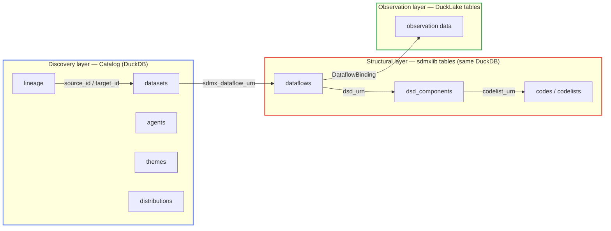
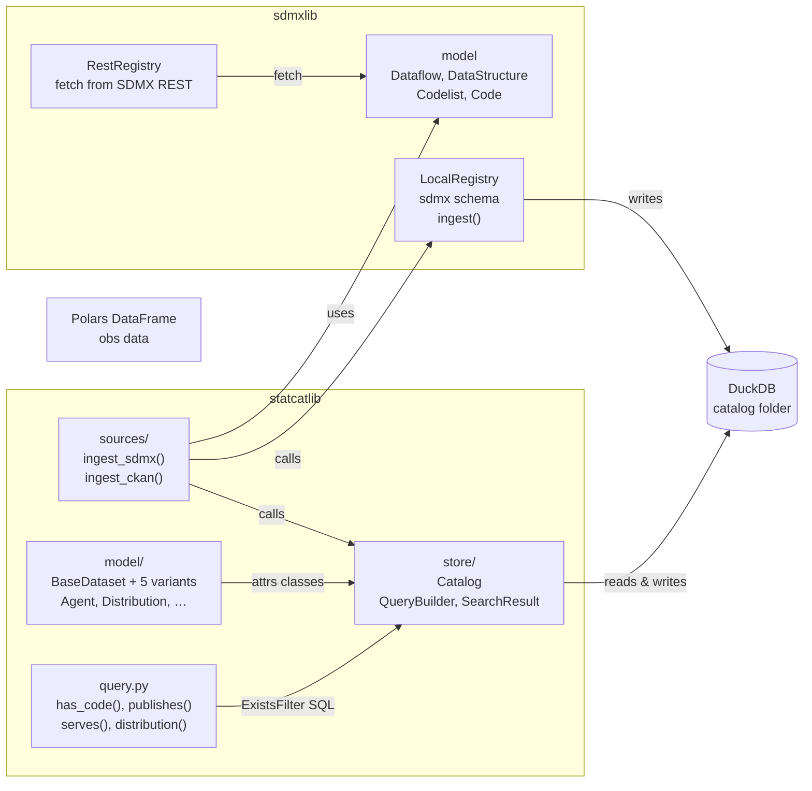
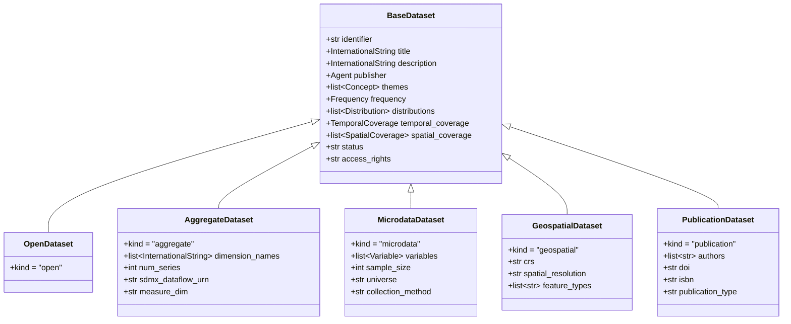
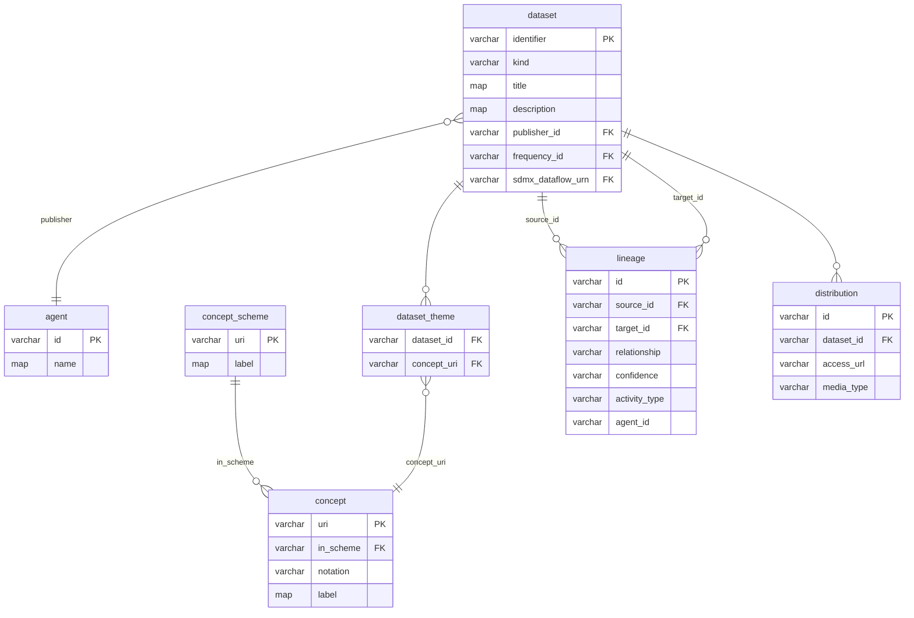

# statcatlib

statcatlib is a Python library for building queryable open data catalog engines.
It is designed for statistical agencies, open data portals, and research
institutions working with DCAT-AP, StatDCAT-AP, CKAN, SDMX, and PROV-O
conventions.

## The discovery problem

Statistical agencies and open data portals publish datasets through a mix of
APIs: SDMX REST endpoints, CKAN portals, institutional REST services. Finding
the right dataset requires knowing which agency publishes it, what dimensions
it covers, what geographic codes are available, whether it is current, and
where it fits in the production chain. statcatlib materializes that metadata
from one or more sources into a local database and answers these questions
with queries against it.

## The three layers

statcatlib keeps discovery, structure and observation data in three separate
layers.



**Discovery layer** — the catalog star schema owned by statcatlib. Queries for
"datasets published by ECB with a GEO dimension" or "all datasets derived from
LFS microdata" run here.

**Structural layer** — SDMX artifacts (`dataflow`, `dsd_component`, `codelist`,
`code`) owned by sdmxlib, ingested into the same DuckDB connection in the `sdmx` schema. Structural
filters (`has_code`, `has_dimensions`) JOIN directly into these tables.

**Observation layer** — the actual numbers. `ingest_data()` writes a dataflow's
observations to a DuckLake table, one row per observation, and registers an
sdmxlib `DataflowBinding` for it. `store.registry.obs(flow)` reads them back as a
Polars frame, long or pivoted.

## The materialized graph

The design is conceptually equivalent to a local RDF graph store, but implemented
in SQL:

| RDF concept | statcatlib equivalent |
|---|---|
| URI | SDMX URN (e.g. `urn:sdmx:...Dataflow=ESTAT:NAMA_10_GDP(1.0)`) |
| Graph federation | Ingest: copy remote artifacts into local DuckDB |
| SPARQL joins | SQL JOINs across catalog and sdmxlib tables |
| Named graph | `kind` column on `dataset` (`open`, `aggregate`, `microdata`, `geospatial`, `publication`) |
| prov:wasDerivedFrom | `lineage.source_id → lineage.target_id` |

statcatlib materializes the full graph on ingest, so a query traverses it with
local SQL JOINs and calls no endpoint.

## Architecture



## Five dataset kinds

statcatlib uses a discriminated union aligned with DCAT-AP and StatDCAT-AP:



| Kind | DCAT-AP alignment | Typical source |
|---|---|---|
| `open` | `dcat:Dataset` | CKAN, open portals, manual curation |
| `aggregate` | `stat:StatDataset` | SDMX REST registries |
| `microdata` | `dcat:Dataset` + DDI | Survey microdata registries |
| `geospatial` | `dcat:Dataset` + GeoDCAT | Spatial data portals |
| `publication` | `dcat:Dataset` + DCMI | Publication and article portals |

## Database schema



!!! note "Schema ownership"
    `dataset`, `agent`, `concept_scheme`, `concept`, `distribution`, `lineage` and
    related bridge tables are in the `statcat` schema, owned by statcatlib. `dataflow`, `dsd_component`,
    `code`, `codelist` are in the `sdmx` schema, owned by sdmxlib. Both live in the same DuckDB
    database and are queried together via cross-schema SQL JOINs. `has_code()` and `has_dimensions()`
    JOIN through the `sdmx` schema via `sdmx_dataflow_urn`.

## Query surface

`Catalog` exposes four operations:

| Operation | Returns | Generic? | Use for |
|---|---|---|---|
| `get(cls, id)` | `T \| None` | Yes | Direct lookup by identifier |
| `query(cls)` | `QueryBuilder[T]` | Yes | Structured filtering and sorting |
| `search(text)` | `SearchResult[BaseDataset]` | No | Full-text BM25 across all datasets |
| `facets(*fields)` | `dict[str, dict[str, int]]` | No | Aggregation counts for UI facets |

`QueryBuilder` supports chaining:

```python
import statcatlib.query as q

results = (
    store.query(sc.AggregateDataset)
    .filter(
        q.has_code("geo", "DE"),
        q.has_dimensions(["geo", "freq"]),
    )
    .filter(publisher="ESTAT")
    .search("exchange rate")
    .include("publisher", "themes")   # load only these relationships
    .sort_by("modified", desc=True)
    .limit(20)
    .with_facets("themes", "frequency")
    .execute()   # → SearchResult[AggregateDataset]
)
```

Cross-entity queries reach through the dataset graph:

```python
# Agents that publish datasets with GEO=CA
store.query(sc.Agent).filter(
    q.publishes(q.has_code("geo", "CA"))
).all()

# Services serving aggregate datasets
store.query(sc.DataService).filter(q.serves(kind="aggregate")).all()
```

Lineage traversal follows PROV-O semantics:

```python
# All upstream sources, transitively
store.dataset("gdp-chained-dollars").upstream(depth=5)

# Impact analysis: datasets that depend on this classification
store.dataset("CL_GEO").downstream(relationship="uses_classification")
```
