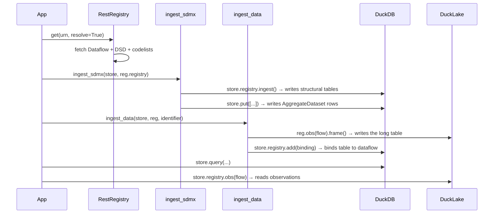
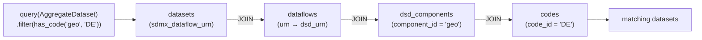

# Tutorial

This tutorial walks through building a catalog from scratch: creating a store,
ingesting data from multiple sources, querying with filters and full-text search,
and tracking provenance with lineage. Each section builds on the previous one.

## Installation

```bash
uv add statcatlib
# or: pip install statcatlib
```

## 1. Create a catalog store

`Catalog` is the single entry point to the catalog. Pass a folder path for
a persistent catalog or omit it for an in-memory store:

```python
import statcatlib as sc

# In-memory — ephemeral, useful for scripts and tests
store = sc.Catalog()

# Catalog folder — persistent across restarts
# Opening it creates my_catalog/ with meta.duckdb, lake.ducklake and parquet/
store = sc.Catalog("my_catalog")
```

Construction is cheap and does not touch the disk. The connection opens on
`.open()`, or on entering a `with` block.

The store is a context manager that closes the connection on exit:

```python
with sc.Catalog("my_catalog") as store:
    ...  # queries and ingests here
```

## 2. Add datasets manually

Any dataset kind can be added directly with `put()`, with no remote source:

```python
from sdmxlib import InternationalString as I18n

# Store a concept scheme before citing its concepts as themes.
# This populates the concept table so theme labels appear in search results.
store.put(sc.ConceptScheme(
    uri="urn:myorg:themes",
    label=I18n(en="My Themes"),
    concepts={"ENV": sc.Concept(notation="ENV", label=I18n(en="Environment"))},
))

# Generic dataset (DCAT-AP dcat:Dataset)
store.put(sc.OpenDataset(
    identifier="co2-emissions-2024",
    title=I18n(en="CO2 Emissions 2024", fr="Émissions CO2 2024"),
    description=I18n(en="Annual CO2 emissions by country"),
    publisher=sc.Agent(id="OECD", name=I18n(en="OECD")),
    themes=(sc.ConceptRef(uri="urn:myorg:themes/ENV"),),
    frequency=sc.Frequency(id="ANNUAL"),
    status="current",
))

# Statistical dataset (StatDCAT-AP stat:StatDataset)
store.put(sc.AggregateDataset(
    identifier="MY:DATASET(1.0)",
    title=I18n(en="My Statistical Dataset"),
    description=I18n(en="Annual counts by region"),
    publisher=sc.Agent(id="NSO", name=I18n(en="National Stats")),
    num_series=420,
))

# Microdata — variable-level metadata
store.put(sc.MicrodataDataset(
    identifier="lfs-2023-q4",
    title=I18n(en="Labour Force Survey 2023 Q4 PUMF"),
    description=I18n(en="Public use microdata file"),
    variables=[
        sc.Variable(id="AGE", label=I18n(en="Age of respondent"), value_type="integer"),
        sc.Variable(id="LFSSTAT", label=I18n(en="Labour force status"), value_type="categorical"),
    ],
    sample_size=56000,
    universe="Civilian non-institutionalized population aged 15+",
))

# Geospatial dataset
store.put(sc.GeospatialDataset(
    identifier="sgc-2021",
    title=I18n(en="Standard Geographical Classification 2021"),
    description=I18n(en="Official Canadian geographic classification"),
    crs="EPSG:4617",
    feature_types=["province", "census_division", "census_subdivision"],
    spatial_coverage=[sc.SpatialCoverage(
        label=I18n(en="Canada"),
        bbox=(-141.0, 41.7, -52.6, 83.1),
    )],
))

# Publication dataset
store.put(sc.PublicationDataset(
    identifier="pub-71-607-x2023017",
    title=I18n(en="Labour Force Survey, December 2023"),
    description=I18n(en="Monthly labour market snapshot"),
    authors=["Statistics Canada"],
    doi="10.25318/7160002201-eng",
    publication_type="release",
))
```

Pass a list or tuple to `put()` to add many datasets at once:

```python
store.put([ds1, ds2, ds3, ...])
```

### Structural filters (`has_code`, `has_dimensions`)

`has_code()` and `has_dimensions()` JOIN through sdmxlib's structural tables
via `sdmx_dataflow_urn`. They only work for datasets created by `ingest_sdmx()`
— there is no `codes=` parameter on `put()`. Manually-curated datasets can be
filtered by publisher, status, keyword, title, and other metadata fields.

## 3. Ingest from SDMX

`ingest_sdmx()` writes SDMX structural artifacts (codelists, DSDs, dataflows)
into the shared DuckDB and creates an `AggregateDataset` catalog record for each
dataflow. `ingest_data()` then writes the observation data for one dataflow into
the bundle's DuckLake and binds the table to the dataflow, so it reads back
through `store.registry.obs(...)`.



### Ingest a single dataflow

```python
import sdmxlib as sl
import statcatlib as sc

with sc.Catalog("my_catalog") as store:
    with sl.RestRegistry(sl.Provider.ESTAT) as reg:
        # resolve() sends references=descendants — one HTTP request returns the
        # Dataflow, its DSD, and all referenced codelists.
        reg.get(sl.Dataflow.urn_for(agency="ESTAT", id="NAMA_10_GDP"), resolve=True)
        sc.ingest_sdmx(store, reg.registry)
```

### Ingest multiple dataflows

`reg.registry` accumulates every artefact across all `resolve()` calls, so you
can fetch several dataflows and ingest once at the end:

```python
DATAFLOWS = ["NAMA_10_GDP", "UNE_RT_M", "PRIC_HPI_IDX"]

with sc.Catalog("my_catalog") as store:
    with sl.RestRegistry(sl.Provider.ESTAT) as reg:
        for df_id in DATAFLOWS:
            reg.get(sl.Dataflow.urn_for(agency="ESTAT", id=df_id), resolve=True)
        sc.ingest_sdmx(store, reg.registry)
```

!!! warning "Memory"
    All resolved artefacts accumulate in `reg.registry` as Python objects before
    being written to DuckDB. For very large ingests, open a fresh `RestRegistry`
    per batch to bound memory use.

### Ingest with publisher and theme overrides

Use `ingest_sdmx_registry()` to stamp a publisher and theme set on every
ingested dataset — useful when all dataflows come from one agency:

```python
publisher = sc.Agent(id="ESTAT", name=I18n(en="Eurostat"))
theme_ref = sc.ConceptRef(uri="urn:myorg:themes/ECONOMY")

sc.ingest_sdmx_registry(store, reg.registry, publisher=publisher, themes=[theme_ref])
```

Themes passed here are `ConceptRef` pointers. Store the corresponding
`ConceptScheme` separately so concept labels are indexed for BM25 search.

### Ingest observation data

`ingest_data()` fetches the observation data for one dataflow and writes it into
the bundle's DuckLake, one row per observation, under `parquet/`. It needs a
folder-mode catalog:

```python
with sc.Catalog("my_catalog") as store:
    with sl.RestRegistry(sl.Provider.ESTAT) as reg:
        reg.get(sl.Dataflow.urn_for(agency="ESTAT", id="NAMA_10_GDP"), resolve=True)
        sc.ingest_sdmx(store, reg.registry)

        # Writes the table estat.df_nama_10_gdp_1_0 and returns its name.
        # measure_dim records the default pivot axis for readers.
        sc.ingest_data(store, reg, "ESTAT:NAMA_10_GDP(latest)", measure_dim="na_item")
```

`ingest_data()` accepts `(latest)` as the version and resolves it to the highest
stored version. Re-running it replaces the table and its binding.

!!! note "Structural vs. observation queries"
    `ingest_sdmx` is all you need for catalog-level discovery: filtering by
    `has_code("geo", "DE")` joins sdmxlib's structural tables and reads no
    observations. Run `ingest_data` when you need the numbers themselves.

## 4. Ingest from CKAN

Any CKAN portal (open.canada.ca, data.gov, data.gov.uk, …) can be ingested using
the `CkanClient`:

```python
from statcatlib.sources.ckan import CkanClient

with sc.Catalog("open_canada") as store:
    with CkanClient("https://open.canada.ca/data") as client:
        datasets = sc.ingest_ckan(
            store, client,
            organization="statcan",
            rows=500,
        )
        print(f"Ingested {len(datasets)} datasets")
```

CKAN datasets are ingested as `OpenDataset` records, with distributions mapped
from CKAN resources.

## 5. Direct lookup

`get()` retrieves a single dataset by identifier and narrows to the requested type:

```python
# Returns AggregateDataset | None
ds = store.get(sc.AggregateDataset, "ESTAT:NAMA_10_GDP(1.0)")

if ds is not None:
    print(ds.title.get("en"))
    print(ds.sdmx_dataflow_urn)
    print(f"{len(ds.dimension_names)} dimensions")
```

Asking for `AggregateDataset` when the stored type is `OpenDataset` (or any
mismatch) returns `None` — type narrowing is strict.

## 6. Structured queries

`query()` returns a `QueryBuilder` for chaining filters before executing:

```python
results = (
    store.query(sc.AggregateDataset)
    .filter(publisher="ESTAT", status="current")
    .sort_by("modified", desc=True)
    .limit(10)
    .execute()
)

print(f"{results.total} total matches, showing {len(results.items)}")
for ds in results.items:
    print(ds.identifier, ds.title.get("en"))
```

### Convenience terminals

```python
items = store.query(sc.AggregateDataset).filter(status="current").all()
ds    = store.query(sc.AggregateDataset).filter(publisher="BIS").first()
ds    = store.query(sc.AggregateDataset).filter(identifier="BIS:CBS_Q(1.0)").one()
n     = store.query(sc.AggregateDataset).filter(status="archived").count()
```

## 7. Composable filter objects

For structural filters and complex conditions, import `statcatlib.query`:

```python
import statcatlib.query as q
```

### Code and dimension filters

```python
# Datasets that include code GEO=DE in their codelist
store.query(sc.AggregateDataset).filter(q.has_code("geo", "DE")).all()

# Datasets with both a GEO and a FREQ dimension
store.query(sc.AggregateDataset).filter(q.has_dimensions(["geo", "freq"])).all()

# Combine: German data with geographic + frequency coverage
store.query(sc.AggregateDataset).filter(
    q.has_code("geo", "DE"),
    q.has_dimensions(["geo", "freq", "age"]),
).all()
```

`has_code` and `has_dimensions` join through sdmxlib's structural tables —
they work on the materialized codelists and DSD components without any
pre-built denormalized index.



### Distribution and service filters

```python
# Datasets with a CSV distribution
store.query(sc.OpenDataset).filter(q.distribution(format="CSV")).all()

# Datasets served by a specific API endpoint
store.query(sc.AggregateDataset).filter(
    q.has_service(endpoint_url="https://sdmx.oecd.org/public/rest")
).all()
```

### Multiple filters are ANDed

```python
# All three conditions must hold simultaneously
store.query(sc.AggregateDataset).filter(
    q.has_code("geo", "CA"),
    q.has_dimensions(["geo", "freq"]),
    q.distribution(format="CSV"),
).all()
```

## 8. Cross-entity queries

`publishes()` and `serves()` extend the query engine to non-dataset entities:

```python
# Agents that publish aggregate datasets with GEO=CA
agents = store.query(sc.Agent).filter(
    q.publishes(q.has_code("geo", "CA"), kind="aggregate")
).all()

# Agents that publish both aggregate and open datasets
agents = (
    store.query(sc.Agent)
    .filter(q.publishes(kind="aggregate"))
    .filter(q.publishes(kind="open"))
    .all()
)

# Data services that serve aggregate datasets
services = store.query(sc.DataService).filter(
    q.serves(kind="aggregate")
).all()

# Combine with field filters — ECB's services only
services = (
    store.query(sc.DataService)
    .filter(q.serves(q.has_code("geo", "DE")))
    .filter(id="ECB-API")
    .all()
)
```

## 9. Full-text search

`search()` runs BM25 full-text search over datasets, concepts and codes, and
ranks the hits by relevance. A dataset is indexed by its title, description,
keywords, theme labels and dimension names. Each result is a `Hit` carrying the
matched entity as `hit.payload`; pass `kinds=("dataset",)` for datasets only.

!!! note "Requires `statcatlib[search]`"
    `store.search()` requires a folder-mode catalog backed by LanceDB. Install
    with `uv add 'statcatlib[search]'` (or `pip install 'statcatlib[search]'`)
    and pass a folder path to `Catalog`.

```python
results = store.search("gross domestic product", kinds=("dataset",), limit=10)
for hit in results.items:
    print(hit.score, hit.payload.title.get("en"))
```

Each language is indexed separately, with its own stemmer. Pass `lang=` to
search anything other than English — the default `"en"` will not match
French text:

```python
results = store.search("produit intérieur brut", lang="fr", limit=10)
```

To combine full-text search with structured filters, use `.search()` on a
`QueryBuilder`:

```python
results = (
    store.query(sc.AggregateDataset)
    .filter(publisher="ESTAT")
    .search("unemployment quarterly")
    .sort_by("modified", desc=True)
    .execute()
)
```

## 10. Facets

`facets()` returns aggregation counts across all datasets — useful for building
filter panels in UIs or understanding catalog composition:

```python
counts = store.facets("publisher", "themes", "frequency", "status")

# {"publisher": {"ESTAT": 42, "ECB": 18, ...},
#  "themes":    {"Economy": 35, "Labour": 22, ...},
#  "frequency": {"MONTHLY": 28, "QUARTERLY": 15, ...},
#  "status":    {"current": 68, "archived": 3}}
```

Request facets alongside a query — counts will reflect only the matched datasets:

```python
results = (
    store.query(sc.AggregateDataset)
    .filter(publisher="ESTAT")
    .include("publisher", "themes")
    .with_facets("themes", "frequency")
    .execute()
)

print(results.facets["themes"])
```

## 11. Selective loading and projections

### Controlling relationship hydration

By default every query loads all ~17 relationships. Use `.include()` to
batch-load only what you need — everything else is set to an `UNLOADED`
sentinel:

```python
# 3 batch queries instead of ~17
items = (
    store.query(sc.BaseDataset)
    .filter(status="current")
    .include("publisher", "themes")
    .all()
)

ds = items[0]
ds.publisher.name    # OK — was included
ds.themes[0]         # raises NotLoadedError: 'themes' was not loaded
```

`sc.NotLoadedError` (a subclass of `AttributeError`) tells you exactly which
field to add to `.include()`. Use `sc.is_unloaded(value)` to test before
accessing:

```python
if not sc.is_unloaded(ds.themes):
    for theme in ds.themes:
        print(theme.label)
```

Use `.full()` to revert to loading everything; `store.get()` always loads all
relationships regardless of `.include()`.

### Row projections

When you only need a few columns, `.select()` bypasses object reconstruction
entirely — one SQL query, no `store.get()` per row. Results are `Row` objects:
a `dict` subclass that supports both dict-style and attribute-style access.

```python
rows = (
    store.query(sc.BaseDataset)
    .filter(status="current")
    .sort_by("title", lang="en")
    .select("identifier", "title", lang="en")
    .rows()
)

for row in rows:
    print(row.identifier, row["title"])  # both access styles work

# Single-column projection
ids = store.query(sc.BaseDataset).scalars("identifier").values()
# → ["EXR", "M1", ...]
```

## 12. Lineage and provenance

statcatlib tracks derivation relationships between datasets using a PROV-O-aligned
model. Record relationships with `add_lineage()`, then traverse them with
`upstream()` and `downstream()`.

### Recording lineage

```python
# Aggregate table derived from survey microdata
store.add_lineage(
    source_id="lfs-microdata",
    target_id="ESTAT:UNE_RT_M(1.0)",
    relationship="aggregated_from",
    activity_type="aggregation",
    activity_label="LFS monthly tabulation",
    confidence="asserted",
)

# Seasonal adjustment
store.add_lineage(
    source_id="ESTAT:UNE_RT_M(1.0)",
    target_id="ESTAT:UNE_RT_M_SA(1.0)",
    relationship="adjusted_from",
    activity_type="seasonal_adjustment",
    activity_label="X-13ARIMA-SEATS",
    confidence="asserted",
)
```

The `relationship` field uses a controlled vocabulary:

| Value | PROV-O equivalent | Meaning |
|---|---|---|
| `derived_from` | `wasDerivedFrom` | Generic derivation |
| `aggregated_from` | `wasDerivedFrom` | Target aggregates source microdata |
| `adjusted_from` | `wasDerivedFrom` | Seasonal / price adjustment |
| `revision_of` | `wasRevisionOf` | Target is a revised version of source |
| `supplement_to` | `wasDerivedFrom` | Target supplements / extends source |
| `feeds_into` | inverse of `wasDerivedFrom` | Source feeds into target computation |
| `uses_classification` | `used` | Dataset depends on a classification |
| `replaces` | `wasRevisionOf` | Target replaces source (archival) |

The `confidence` field tracks how the relationship was established:
`"asserted"` (manual curation), `"extracted"` (automated scraping),
`"inferred"` (LLM output).

### Traversing lineage

`upstream()` and `downstream()` return a `QueryBuilder[BaseDataset]` — call
`.collect()` (or any other terminal) to materialise the results:

```python
# All upstream sources of the unemployment table, transitively
ancestors = store.dataset("ESTAT:UNE_RT_M(1.0)").upstream(depth=5).collect()

# Only follow aggregation edges
agg_sources = store.dataset("ESTAT:UNE_RT_M(1.0)").upstream(relationship="aggregated_from").collect()

# Impact analysis: all datasets that depend on CL_GEO
affected = store.dataset("CL_GEO").downstream(relationship="uses_classification").collect()

# Because the return is a QueryBuilder, you can chain before materialising
current_descendants = (
    store.dataset("lfs-microdata")
    .downstream()
    .filter(status="current")
    .include("publisher")
    .collect()
)

# Direct inspection of lineage records
rows = store.dataset("ESTAT:UNE_RT_M(1.0)").lineage_records(
    role="target",              # this dataset is the derived output
    relationship="aggregated_from",
    confidence="asserted",
)
for r in rows:
    print(r["source_id"], "→", r["target_id"], r["activity_label"])
```

## 13. Reading observations

`ingest_data()` binds its table to the dataflow, so the co-located sdmxlib
registry reads it back. `store.registry.obs(flow)` returns a lazy query in
sdmxlib's query language; nothing is read until a terminal such as `.frame()`
or `.pivot()`:

```python
import sdmxlib as sl

ds = store.get(sc.AggregateDataset, "ESTAT:NAMA_10_GDP(1.0)")
flow = sl.Dataflow.parse_urn(ds.sdmx_dataflow_urn)
obs = store.registry.obs(flow)

# Long layout: one row per observation, a column per dimension and measure
annual_de = obs.filter(obs.col("freq") == "A", obs.col("geo") == "DE").frame()

# Wide layout: one column per code of the pivot axis ingest_data recorded
wide = obs.filter(obs.col("geo") == "DE").pivot(on=ds.measure_dim)
```

Both terminals return a `polars.DataFrame`, typed from the DSD: codes come back
as their codelist's `pl.Enum`. Hand the frame to Polars for anything further,
for example `annual_de.lazy().sort("TIME_PERIOD")`.

## 14. Persistent catalog workflow

For a catalog that survives restarts, use a folder path. The structural graph,
the observation tables and their bindings all survive close and reopen, so no
re-ingest is needed:

```python
# First run — ingest
with sc.Catalog("my_catalog") as store:
    with sl.RestRegistry(sl.Provider.ESTAT) as reg:
        reg.get(sl.Dataflow.urn_for(agency="ESTAT", id="NAMA_10_GDP"), resolve=True)
        sc.ingest_sdmx(store, reg.registry)
        sc.ingest_data(store, reg, "ESTAT:NAMA_10_GDP(latest)", measure_dim="na_item")

# Subsequent runs — query and read observations, no network
with sc.Catalog("my_catalog") as store:
    ds = store.get(sc.AggregateDataset, "ESTAT:NAMA_10_GDP(1.0)")
    obs = store.registry.obs(sl.Dataflow.parse_urn(ds.sdmx_dataflow_urn))
    wide = obs.pivot(on=ds.measure_dim)
```

## Putting it all together

A complete multi-source catalog:

```python
import sdmxlib as sl
import statcatlib as sc
import statcatlib.query as q
from sdmxlib import InternationalString as I18n

with sc.Catalog("national_stats") as store:

    # --- Eurostat SDMX ---
    with sl.RestRegistry(sl.Provider.ESTAT) as reg:
        for df_id in ["UNE_RT_M", "LFSI_EMP_M"]:
            reg.get(sl.Dataflow.urn_for(agency="ESTAT", id=df_id), resolve=True)
        sc.ingest_sdmx(store, reg.registry)

    # --- Manual curation ---
    store.put(sc.OpenDataset(
        identifier="custom-dataset-001",
        title=I18n(en="Custom Dataset"),
        description=I18n(en="Manually curated"),
    ))

    # --- Discovery queries ---

    # Statistical datasets about unemployment with German geography
    unemployment = (
        store.query(sc.AggregateDataset)
        .filter(q.has_code("geo", "DE"))
        .search("unemployment")  # requires statcatlib[search]
        .all()
    )

    # Agents that publish aggregate datasets
    agents = store.query(sc.Agent).filter(q.publishes(kind="aggregate")).all()

    # Counts by theme, publisher and frequency
    print(store.facets("themes", "publisher", "frequency"))

    # --- Lineage ---
    store.add_lineage(
        "14100287",
        "lfs-summary-2024",
        "aggregated_from",
        confidence="asserted",
    )
    ancestors = store.dataset("lfs-summary-2024").upstream().collect()
```
